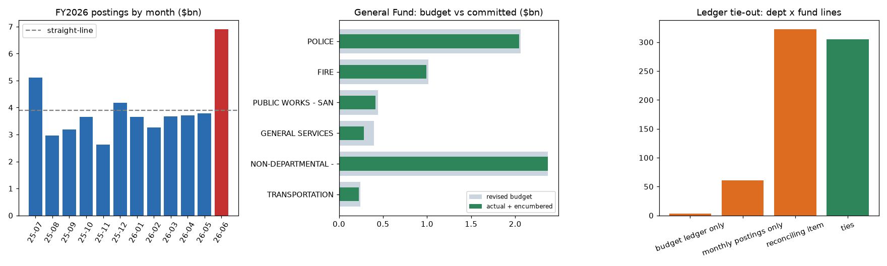

# LA City month-end close & budget-vs-actual (FY2026)

A month-end close and budget-vs-actual pack built on the **City of Los Angeles Controller's real general-ledger extracts** for FY2026 (Jul 2025 to Jun 2026). It includes a subledger-to-ledger tie-out, General Fund BvA, automated close checks, an Excel close pack and a Power BI-ready star schema with DAX measures.



## Business problem
At every close, a finance team has to prove three things: that monthly postings tie to the budget ledger, where spend stands against the revised budget, and which postings need a second look before sign-off. This repo automates those three steps in SQL and produces a reviewable workpaper.

## Data
- **City Expenditures by Month**, LA City Controller, Socrata [`3ctd-sjrm`](https://controllerdata.lacity.org/d/3ctd-sjrm): monthly postings by department × fund × account.
- **City Budget and Expenditures**, LA City Controller, Socrata [`uyzw-yi8n`](https://controllerdata.lacity.org/d/uyzw-yi8n): adopted and revised budget, actuals and encumbrances by budget fiscal year.
- `python ingest/download.py` pulls both (FY2024 to FY2026 filter) and writes a SHA-256 manifest. Raw data is not committed.

## Method
1. `sql/01_model.sql`: staging with `TRY_CAST` to decimals, a star schema (`dim_department`, `dim_fund`, `dim_account`, `dim_period` mapping fiscal to calendar months) and two facts (`fct_actual_monthly`, `fct_budget`).
2. `sql/02_close.sql` (FY passed as a DuckDB variable):
   - **Tie-out**: monthly postings vs budget-ledger total expenditures by department × fund, classified as ties, reconciling item, or one-sided.
   - **General Fund BvA**: adopted → revised → actual + encumbrance, with remaining budget and utilisation.
   - **Over-committed accounts**: General Fund lines where committed spend exceeds revised budget.
   - **Close checks**: negative net postings (reversals/credits), spikes above 5x the line's median month (floor $10k) and missing periods.
   - **Phasing**: monthly share of spend vs a straight-line budget.
3. Outputs: `reports/close_pack_fy2026.xlsx` (5 tabs), `powerbi/*.csv` (star schema for FY2025-26) and `powerbi/measures.dax` (YTD, PY, YoY, utilisation, straight-line phasing variance, ledger difference).

## Key findings (FY2026)
- **Tie-out**: monthly postings total $46.69bn vs $47.17bn in the budget ledger, a net difference of **-$484.4m**. **305 of 691** department × fund lines tie to the cent. 322 carry reconciling items, and 61 have postings with no budget line. The largest differences are Non-Departmental - Appropriations To Special Purpose Fund fund 27M (-$386.5m); Non-Departmental - Appropriations To Special Purpose Fund fund 208 (-$150.9m); Fire fund 298 (-$92.5m). The likely cause is timing: the budget extract is keyed by *budget* fiscal year (spend against prior-year appropriations and encumbrances), while postings are keyed by *transaction* month. This is an inference from the dataset definitions, not confirmed by the Controller.
- **General Fund BvA**: the budget went from $9.56bn adopted to **$10.19bn revised** (+$628.1m in-year; the biggest moves were General Services (+$177.9m), Non-Departmental - General (+$138.2m), Fire (+$116.4m)). Committed spend was **$9.72bn** ($9.55bn actual + $170.3m encumbered), or **95.4% utilisation**, leaving $471.2m unspent.
- Lowest utilisation among departments with more than $50m budget: General Services 71.6% of $397.9m; Non-Departmental - General City Purposes 71.8% of $263.5m; Mayor 76.6% of $89.1m.
- **No General Fund account was committed above its revised appropriation**. Appropriation control held at line level.
- **Phasing**: June (year-end) carried **14.8%** of the year's postings and July 10.9%, against 8.3% straight-line. That is a year-end accrual and true-up pattern a monthly forecast must allow for.
- **Close checks**: 733 negative net postings (total -$602.0m) and 326 spikes above 5x the line median were flagged for review. 0 periods are missing.
- Total postings grew **6.5%** from FY2025 ($43.84bn).

## Skills shown
GL/subledger reconciliation logic · budget vs actual and encumbrance accounting · month-end close checks · SQL (DuckDB: CTEs, window functions, full outer joins) · star-schema modelling for Power BI with DAX measures · Excel workpaper automation (pandas/openpyxl) · Python · pytest · GitHub Actions.

## How to run
```bash
pip install -r requirements.txt
python ingest/download.py && python run.py
python -m pytest -q        # unit tests run on a small hand-made fixture in tests/fixtures
```
To use the star schema in Power BI, load `powerbi/*.csv`, create the relationships listed at the top of `measures.dax`, then paste in the measures.

## Honest caveats
- **No Power BI file (.pbix) is included.** The DAX was written as text mirroring the SQL and has not been validated in Power BI Desktop.
- These are public extracts, not a live ERP. "Close" here means analytics over posted data, not journal entry or approval workflow.
- The explanation for the reconciling items is inferred from the dataset definitions.
- This is an independent portfolio project, not work for the City of Los Angeles.

MIT licence · Amir Khan
